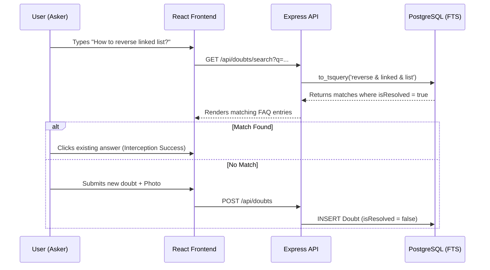

# Innovation and Differentiation Strategy

## 1. Document Information
* **Project Name:** Doubt-Chain
* **Document Title:** Innovation and Differentiation Strategy
* **Version:** 1.0.0
* **Research Date:** October 27, 2026
* **Status:** Draft - Ready for Implementation
* **Related Documentation:** `06-PRD.md`, `existing_solution.md`
* **Purpose of this Document:** To identify, define, and technically validate how Doubt-Chain provides meaningful, measurable value beyond existing academic communication platforms.

## 2. Executive Summary
Doubt-Chain addresses the critical issue of "community knowledge decay" in higher education. Existing solutions force a trade-off: students use WhatsApp for low-friction input (voice/photos), but lose the data to chronological burying; alternatively, they use formal LMS forums which preserve data but have high input friction. 

The most important innovation gap is the lack of **proactive duplicate prevention** combined with **frictionless input**. Doubt-Chain differentiates itself through a "Search-Before-Posting" UI Interceptor and a dynamic state-shift that automatically converts resolved chat-style threads into a permanent subject FAQ. The strongest recommended innovation for the MVP is the Search Interceptor, whose value will be demonstrated live by showing how the UI actively blocks duplicate question creation.

## 3. Problem and User Needs
* **Underlying Problem:** Syllabus-specific academic explanations provided by peers are lost within 24 hours in unstructured chat groups, causing redundant work.
* **Target Users:** University students (Askers and Solvers) and guiding faculty.
* **Existing Workflows:** A student stuck on a lab assignment takes a photo, posts it to a WhatsApp group, and a senior replies. 
* **Unmet User Needs:** 
  * The need to instantly check if a peer has already solved the exact same lab problem.
  * The need to capture complex engineering/math questions without painfully typing them out.
  * The need for syllabus-specific validation (local context) rather than generic internet answers.

## 4. Existing Solutions: Current Capabilities
Based on `existing_solution.md`, the landscape includes:
* **WhatsApp/Discord:** 
  * *Capabilities:* Real-time chat, multimodal input (voice notes, photos).
  * *Strengths:* Zero friction, high adoption.
  * *Limitations:* Temporal decay; impossible to search for an image of a math problem a week later [R1].
* **Stack Overflow / Quora:**
  * *Capabilities:* Markdown Q&A, upvoting, permanent search indexing.
  * *Strengths:* High data permanence, quality control.
  * *Limitations:* High input friction (text-heavy), hostile to duplicate questions, lacks hyper-local university context [R2].
* **University LMS (Canvas/Moodle/Piazza):**
  * *Capabilities:* Subject-wise categorization, professor endorsements.
  * *Limitations:* Clunky UX, low student adoption for quick, late-night peer debugging [R3].

## 5. Innovation Gap Analysis

| Gap ID | Unmet Need | Existing Approach | Evidence | User Impact | Confidence |
| :--- | :--- | :--- | :--- | :--- | :--- |
| **G-01** | Proactive Duplicate Prevention | StackOverflow relies on manual moderator deletion [R2]. Discord relies on scrolling [R1]. | Visual inspection of platform UI. | High (Reduces Solver fatigue) | Verified limitation |
| **G-02** | Retaining Knowledge from Chat | WhatsApp pushes old messages out of view chronologically. | Platform architecture design. | High (Prevents knowledge loss) | Verified limitation |
| **G-03** | Frictionless Permanent Archiving | LMS forums require rigid text input; students prefer snapping photos [R3]. | EdTech UX Research / Observation. | Medium (Increases adoption) | Evidence-supported opportunity |

## 6. Innovation Principles
1. **Solve a genuine workflow problem:** Prioritize reducing duplicate questions over adding flashy AI wrappers.
2. **Reduce unnecessary complexity:** Keep the input as frictionless as a WhatsApp message.
3. **Build within 24 hours:** Rely on PostgreSQL's native Full-Text Search rather than over-engineering an ElasticSearch cluster.
4. **Support a credible live demo:** Visual state changes (e.g., a thread physically moving from "Unresolved" to "FAQ") must be immediately observable.

## 7. Proposed Differentiating Features

### Feature ID: Feat-01 - "Search-Before-Posting" Interceptor
* **Problem Addressed:** Duplicate questions cluttering the platform.
* **Existing Approach:** Forums have a passive search bar at the top, which users ignore.
* **Proposed Approach:** The "Ask a Doubt" input field doubles as the search bar. As the user types, a dropdown actively intercepts the workflow, forcing them to view matching resolved doubts before the "Submit" button is enabled.
* **User Value:** Saves the Asker time (instant answer) and saves the Solver time (no repeated explanations).
* **Technical Implementation:** PostgreSQL `tsvector` and `tsquery` for rapid lexical search via an Express.js API endpoint.
* **Feasibility:** High. Can be implemented in 24 hours.
* **Validation:** Measure the "Interception Rate" (queries that do not result in a new post).
* **Novelty:** Better solution for a specific use case (repositioning UX to force behavior).

### Feature ID: Feat-02 - Dynamic FAQ State-Shift (Chat to FAQ)
* **Problem Addressed:** Forums become unreadable over time due to cluttered, unresolved, or dead threads.
* **Existing Approach:** A forum post remains in the main feed forever.
* **Proposed Approach:** When an Asker clicks "Mark as Resolved," the thread undergoes a database state shift (`isResolved: true`). The UI immediately removes it from the chaotic "Unresolved" feed and appends it to a clean, read-only "FAQ" accordion.
* **User Value:** Automatically builds a clean revision asset for midterm studying.
* **Technical Implementation:** Simple boolean toggle in PostgreSQL (Prisma); React Router filtering based on the boolean state.
* **Feasibility:** High. Very low technical risk.
* **Validation:** Visual confirmation during the demo.
* **Novelty:** Novel combination of established capabilities.

### Feature ID: Feat-03 - Frictionless Multi-Modal Input
* **Problem Addressed:** Typing math, physics, or code is frustrating on mobile.
* **Existing Approach:** StackOverflow requires strict Markdown.
* **Proposed Approach:** Native support for uploading photos and recording HTML5 voice notes directly in the browser.
* **User Value:** Matches the ease of WhatsApp while maintaining forum-level categorization.
* **Technical Implementation:** Cloudinary/AWS S3 for blob storage; HTML5 `MediaRecorder` API for voice.
* **Feasibility:** Medium. (Requires careful frontend payload sizing to avoid timeout).
* **Validation:** Successful upload and playback during the demo.
* **Novelty:** Improvement to an existing approach.

## 8. Innovation Prioritization Matrix

| Feature ID | User Impact | Differentiation | Feasibility | Demo Value | Dev Effort | Priority |
| :--- | :--- | :--- | :--- | :--- | :--- | :--- |
| **Feat-01 (Interceptor)** | High | High | High | High | Medium | **1 (Must Have)** |
| **Feat-02 (FAQ Shift)** | High | High | High | High | Low | **2 (Must Have)** |
| **Feat-03 (Multi-Modal)** | Medium | Medium | Medium | High | High | **3 (Must Have)** |

*Recommended for MVP:* Feat-01, Feat-02, and the Photo-upload portion of Feat-03.

## 9. Technical Differentiation

The core technical differentiator is the architectural flow that forces duplicate prevention and automated data curation.

* **Why it improves UX:** By placing the FTS search *ahead* of the POST route on the frontend UI, we prevent database bloat and instantly unblock the student.

## 10. Feature Comparison: Existing Solutions vs Doubt-Chain

| Capability | WhatsApp / Discord | Stack Overflow | Piazza | Doubt-Chain |
| :--- | :--- | :--- | :--- | :--- |
| **Core: Subject Categorization** | Partially available | Partially available | Available | **Planned** |
| **Core: Multi-modal (Voice/Photo)** | Available | Not found | Partially available | **Planned** |
| **Workflow: "Mark as Resolved"** | Not found | Available | Available | **Planned** |
| **Diff: Pre-Post Interceptor** | Not found | Partially available | Not found | **Planned** |
| **Diff: Auto-FAQ Generation** | Not found | Not found | Not found | **Planned** |
| **Eval: Interception Tracking** | Not verified | Documented method | Not verified | **Planned validation** |

## 11. Innovation Validation Strategy
* **Baseline Selection:** Standard forum workflow (e.g., a basic CRUD message board with a standard search bar).
* **Test Scenario:** Ask a judge to ask a question that already exists in the database.
* **Evaluation Metric:** The UI must successfully gray-out the "Submit" button until the search results are acknowledged or cleared.
* **Expected Result:** Immediate surfacing of the resolved query, proving the interception mechanism works.

## 12. MVP Innovation Scope
* **Must-Have:** 
  * "Search-Before-Posting" Interceptor UI.
  * The `isResolved` boolean toggle and the distinct FAQ view.
  * Photo upload integration via Cloudinary/S3.
* **Should-Have:** 
  * Markdown support for code blocks (`react-markdown`).
* **Could-Have:** 
  * Voice note recording via `MediaRecorder`.
* **Out of Scope:** 
  * Real-time WebSockets (adds too much risk for a 24h hackathon).
  * AI-based audio transcription.

## 13. Risks and Limitations
* **Risk:** PostgreSQL Full-Text Search introduces latency if not indexed properly.
  * *Mitigation:* Create a GIN (Generalized Inverted Index) on the title/content columns during Prisma migration.
* **Risk:** Empty state during the live demo makes the Search Interceptor look useless.
  * *Mitigation:* Write a backend seed script to populate the database with 30-40 realistic, syllabus-specific CS questions prior to judging.

## 14. Unique Value Proposition
"Existing solutions provide *real-time communication (WhatsApp)* or *permanent global archiving (Stack Overflow)*. However, *the loss of syllabus-specific knowledge due to chat decay* remains a challenge for *university students*. Doubt-Chain proposes to address this through a *proactive Search-Before-Posting interceptor and an automated FAQ state-shift*. We will evaluate its effectiveness using *visual demonstration of query interception and duplicate reduction*."

* **One-Sentence:** Doubt-Chain replaces chaotic WhatsApp groups by forcing students to search resolved academic queries before posting, automatically building a permanent class FAQ.
* **30-Second Pitch:** "When a student answers a doubt in WhatsApp, that brilliant explanation is buried within hours. When another student asks it tomorrow, they get ignored. Doubt-Chain fixes this. We combine the frictionless photo uploads of chat apps with the permanence of a forum. By forcing a search before a user can post, and automatically converting resolved threads into a clean FAQ, we ensure no syllabus-specific question ever needs to be answered twice."

## 15. Judges’ Evaluation (Anticipated Objections)

1. **Objection:** *"Why wouldn't a student just ask ChatGPT?"*
   * **Response:** "ChatGPT provides generic internet answers that often hallucinate on niche constraints. Doubt-Chain captures hyper-local context—how our specific professor grades this specific lab assignment, validated by seniors who already took the class."
2. **Objection:** *"Isn't this just Quora or StackOverflow for colleges?"*
   * **Response:** "StackOverflow optimizes for global reach and requires high-friction formatting. We optimize for local context and low-friction input (photos/voice), mirroring how students actually study, gated by a strict duplicate-prevention UI."
3. **Objection:** *"Why wouldn't students just use Discord channels?"*
   * **Response:** "Discord channels are still temporal feeds. Once a thread scrolls up, it's effectively gone. Doubt-Chain features a dynamic state-shift: once a doubt is resolved, it leaves the chat feed and becomes a permanent, searchable FAQ."
4. **Objection:** *"Is the 'Search-Before-Posting' really an innovation?"*
   * **Response:** "Yes, as a UX paradigm shift. Social apps optimize for content creation. We optimize for knowledge retrieval by placing the search query as a strict dependency *before* the POST request can fire, actively reducing database bloat."
5. **Objection:** *"You claim this reduces duplicate questions, but how can you prove that today?"*
   * **Response:** "While we need longitudinal data for exact percentages, our live demo proves the mechanical capability. As you can see on stage, the system physically prevents me from submitting a duplicate title without first interacting with the intercepted results."

## 16. Final Recommendations
* **Strongest Innovation Gap:** The lack of proactive duplicate prevention in student communication workflows.
* **Recommended MVP Differentiator:** The UI-level Search Interceptor powered by PostgreSQL FTS.
* **Next Steps:** Finalize the Prisma schema, set up the Cloudinary API keys, and immediately build the seed script to ensure the demo has data to search against.

## 17. References
* **[R1]** WhatsApp / Discord Core Architecture (Public knowledge regarding temporal messaging queues).
* **[R2]** Stack Overflow Guidelines (Public documentation regarding duplicate question flagging and formatting).
* **[R3]** EdTech UX Observations (General consensus regarding high friction in traditional LMS platforms like Piazza).
* **[R4]** Graphite 26 Problem Statement Booklet: PS 14 (Source of requirements).