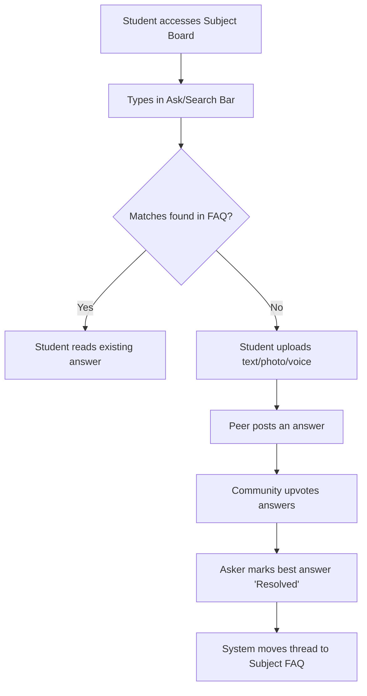

# PRD.md

## 1. Document Information
* **Product Name:** Doubt Chain
* **Problem Statement ID & Title:** PS 14: Doubt Chain - Peer-to-Peer Doubt Resolution Tracker
* **Hackathon Name:** Graphite 26 Hackathon
* **Document Version:** 1.0.0
* **Creation Date:** 2026-10-27
* **Document Status:** DRAFT - Ready for MVP Development
* **Project Stakeholders:** Hackathon Judges, University Administration (e.g., Graphic Era Hill University)

## 2. Executive Summary
**Doubt Chain** is a hyper-local, peer-to-peer academic resolution platform designed for university ecosystems. It solves the problem of "community knowledge decay," where valuable peer-provided solutions are lost in chaotic, unsearchable WhatsApp or Discord groups. By providing a subject-wise dashboard with frictionless multi-modal input (text, photo, voice), Doubt Chain captures ephemeral academic discussions. Its core differentiating capability is the "Search-Before-Posting" gatekeeper and the dynamic state-shift that automatically converts resolved threads into a permanent, searchable FAQ. The hackathon MVP will demonstrate a functioning subject board, the active interception of duplicate queries, and the automated generation of an FAQ database upon doubt resolution.

## 3. Background and Problem Statement
* **Official Problem Statement:** Students post doubts in random WhatsApp or Discord groups, where questions get buried quickly, answered inconsistently, or never resolved. 
* **Problem Context:** Because chat history lacks structure, the exact same doubt is asked again a week later by another student. 
* **Root Causes:** Synchronous chat platforms prioritize chronological feeds over information retrieval and archiving.
* **Affected Stakeholders:** 5th-semester CS students dealing with redundant friction; seniors suffering from "answer fatigue"; professors lacking visibility into student blockers.
* **Consequences of Unresolved Problem:** Wasted peer effort, repetitive questions, and loss of syllabus-specific knowledge at the end of each semester.

## 4. Product Vision and Objectives
* **Product Vision:** To become the institutional memory for university classrooms, ensuring no academic question ever needs to be answered twice.
* **Primary Objectives:**
  * Build a searchable repository of resolved academic doubts.
  * Reduce duplicate student questions by at least 50% via forced search mechanisms.
* **Secondary Objectives:** Provide faculty with an analytics dashboard to track high-friction syllabus topics.
* **Expected User Benefits:** Instant access to peer-reviewed, syllabus-specific answers (e.g., data structures, circular queues, recursion).
* **Explicit Non-Goals:** We are not building a real-time chat application or a global generative AI tutor. 

## 5. Target Users and Personas
1. **The Asker (Junior/Peer Student)**
   * *Role:* B.Tech CS Student.
   * *Needs:* Quick answers to lab assignments; frictionless input (photos of handwritten math/code).
   * *Pain Points:* Typing complex algorithms; waiting for professors to reply via email.
2. **The Solver (Senior/Peer Student)**
   * *Role:* Senior developer or peer excelling in the subject.
   * *Needs:* Recognition for helping peers; a streamlined way to provide code-formatted answers.
   * *Pain Points:* Answering the same recursion question five times in a WhatsApp group.
3. **The Observer (Faculty Guide - Proposed)**
   * *Role:* Assistant Professor.
   * *Needs:* Visibility into what concepts the class is struggling with before the midterm.

## 6. Existing Solutions and Competitive Landscape
* **WhatsApp / Discord:** Low friction, supports media natively, but offers zero searchability and loses data within hours.
* **Quora / StackOverflow:** High searchability, but lacks local Graphic Era syllabus context. High friction for informal student queries.
* **University LMS (Canvas/Moodle):** High friction, outdated UI, low student adoption for late-night debugging.
* **Innovation Opportunity:** Combining WhatsApp's low-friction input (voice/image) with StackOverflow's permanence, gated by an active search-first interceptor.

## 7. Proposed Solution
Doubt Chain is a web-based platform structured around subject-specific boards. When a student attempts to ask a question, an intercepting search bar dynamically queries the database for matching resolved doubts. If no match is found, the student can post the doubt using text, an uploaded photo, or a recorded voice note. Peers provide threaded answers. Once the asker marks the best answer as "Resolved," the thread is automatically removed from the active queue and permanently appended to the subject's searchable FAQ.

## 8. Product Scope
### 8.1 In Scope (Hackathon MVP)
* Subject-wise doubt boards.
* Text, photo, and voice note upload capabilities.
* Threaded replies and peer upvoting.
* "Mark as Resolved" state-toggle.
* "Search-Before-Posting" interceptor UI.
* Auto-generated FAQ view.

### 8.2 Out of Scope
* Real-time WebSockets/live typing indicators.
* Complex user reputation/gamification economies.
* Direct messaging (DMs) between users.

### 8.3 Future Scope
* Faculty analytics dashboard.
* Web Speech API integration for auto-transcribing voice notes into searchable text.
* AI-generated summaries of long doubt threads.

## 9. Functional Requirements
| Req ID | Requirement | User/Actor | Priority | Dependencies | Acceptance Criteria |
| :--- | :--- | :--- | :--- | :--- | :--- |
| FR-001 | System must enforce a search query before allowing post creation. | Asker | Must Have | DB Search Index | "Submit" button remains disabled until search is executed. |
| FR-002 | Users can upload text, photos, or voice notes. | Asker | Must Have | Cloudinary/S3 API | Media is uploaded and URL is stored in Postgres. |
| FR-003 | Users can browse doubts categorized by subject. | All Users | Must Have | Subject DB Schema | Routing filters doubts correctly by subject ID. |
| FR-004 | Users can upvote peer answers. | All Users | Should Have | Auth System | Upvote count increments by 1 per unique user. |
| FR-005 | Asker can mark one answer as "Resolved". | Asker | Must Have | Thread Schema | Doubt state changes to `isResolved: true`. |
| FR-006 | Resolved doubts must populate the FAQ section. | System | Must Have | FR-005 | FAQ route only queries/displays `isResolved: true` entries. |

## 10. Non-Functional Requirements
| Req ID | Description | Target | Validation | Priority |
| :--- | :--- | :--- | :--- | :--- |
| NFR-001 | **Performance:** Search-before-posting query must return results rapidly. | < 300ms | Chrome DevTools Network tab | Must Have |
| NFR-002 | **Usability:** Interface must be fully responsive for mobile studying. | 100% Mobile UI | Manual device testing | Must Have |
| NFR-003 | **Storage Constraint:** Media uploads must not exceed payload limits. | < 5MB per file | Frontend file size validation | Must Have |

## 11. User Stories and Use Cases
* **US-01:** As a student, I want to search the database before posting, so that I don't waste time asking a question that has already been answered.
* **US-02:** As a student, I want to upload a photo of my digital logic circuit, so that I don't have to spend 20 minutes describing it in text.
* **US-03:** As a peer solver, I want to write answers with markdown code blocks, so that my code is readable.
* **US-04:** As an asker, I want to mark the best answer as resolved, so that the community knows my problem is fixed and the thread can be added to the FAQ.

## 12. User Journey and Workflow

## 13. UI/UX Requirements
* **Main Dashboard:** Clean, categorized grid of subjects (e.g., Data Structures, OOP, Digital Logic).
* **The Interceptor (Ask Page):** A large, prominent input field. As the user types, a dropdown populates with existing resolved queries.
* **Thread View:** StackOverflow-style layout, but with embedded image/audio players. Distinct visual highlight for the "Best Answer" marked by the asker.
* **FAQ View:** A simplified, read-only accordion-style view of resolved questions for rapid exam revision.

## 14. Data Requirements
* **Data Sources:** User-generated content.
* **Formats:** Text (Markdown), Images (JPEG/PNG), Audio (WebM/MP3).
* **Storage Requirements:** Neon PostgreSQL (using Prisma ORM). Images/Audio must not be stored as binary blobs in the DB; they must be offloaded to an external bucket, saving only the URL string.
* **Validation:** Zod validation on the backend to ensure empty posts cannot be submitted.

## 15. Integrations and External Dependencies
* **Cloudinary / AWS S3:** Required for handling photo and voice note uploads. Free-tier limits apply.
* **Neon PostgreSQL:** Required for relational database management and Full-Text Search indexing.
* **Web API (MediaRecorder):** Native browser API required for capturing voice notes on the client side.

## 16. Innovation and Differentiation
* **Gap:** Existing solutions fail to prevent duplicate questions.
* **Proposed Feature:** The mandatory search-before-posting UI interceptor.
* **Why it matters:** It shifts the platform from a "social feed" to an "academic wiki," ensuring knowledge compounds rather than decays.
* **Evaluation:** Compare the number of duplicate questions created in a standard forum UI versus the interceptor UI.

## 17. Success Metrics and KPIs
| Metric ID | Metric | Definition | Target | Priority |
| :--- | :--- | :--- | :--- | :--- |
| M-01 | Interception Rate | % of users who search and do not proceed to post a new doubt. | > 40% (Hypothesis) | High |
| M-02 | Resolution Velocity | Average time from post creation to being marked "Resolved". | TBD | Med |
| M-03 | FAQ Growth | Number of resolved queries added to the permanent database per week. | TBD | High |

## 18. Acceptance Criteria and Definition of Done
* **Feature Acceptance:** A user can successfully upload an image, a peer can reply, and the author can toggle the `isResolved` state, which successfully removes the post from the "Unresolved" feed and adds it to the FAQ.
* **Demo-Readiness:** The database is seeded with at least 30 realistic dummy records covering 5th-semester computer science topics. The search interceptor must instantly return relevant dummy records live on stage.

## 19. Constraints and Assumptions
* **Hackathon Duration:** 24-hour limit heavily restricts the ability to build custom NLP search engines; PostgreSQL Full-Text Search will be utilized instead.
* **Hardware/Network Limitations:** Unstable venue Wi-Fi may disrupt large image uploads.
* **Assumption:** We assume the HTML5 MediaRecorder API will function reliably across all judges' mobile/desktop browsers during testing.

## 20. Risks and Mitigation
| Risk ID | Risk | Likelihood | Impact | Mitigation |
| :--- | :--- | :--- | :--- | :--- |
| R-01 | Cloudinary free-tier rate limits exceeded during demo. | Low | High | Implement strict 2MB frontend file size limits. |
| R-02 | PostgreSQL `ilike` search query becomes too slow. | Med | Med | Use raw SQL in Prisma to create a GIN index on text columns. |
| R-03 | Live demo fails due to empty initial state. | High | High | Pre-load DB with high-quality, syllabus-specific dummy data. |

## 21. Deployment and Environment Requirements
* **Frontend:** Vercel (React/Vite).
* **Backend:** Render or Vercel Serverless (Node.js/Express).
* **Database:** Neon DB (Serverless Postgres).
* **Env Variables Required:** `DATABASE_URL`, `JWT_SECRET`, `CLOUDINARY_API_KEY`, `CLOUDINARY_API_SECRET`.

## 22. Testing and Validation Strategy
* **Functional Testing:** Manually verify that the "Mark as Resolved" button accurately triggers the database state change and updates the UI cache immediately via TanStack Query.
* **Search Testing:** Execute partial keyword searches (e.g., "circul" for "circular queue") to validate the Postgres indexing.

## 23. Dependencies and Implementation Priorities
1. **Critical Path 1:** Prisma Database Schema & Auth implementation.
2. **Critical Path 2:** Express API routes for CRUD operations on Doubts and Answers.
3. **Critical Path 3:** The Search-Interceptor UI and Postgres search logic.
4. **Critical Path 4:** Cloudinary integration for media uploads.
5. **Defer if short on time:** Advanced sorting algorithms for the FAQ page; stick to simple chronological sorting.

## 24. Open Questions and Pending Decisions
| Q ID | Unresolved Question | Decision Owner | Deadline | Status |
| :--- | :--- | :--- | :--- | :--- |
| OQ-01 | Should we enforce a strict character limit on text doubts to encourage concise questions? | Team | H-Hour 2 | Pending |
| OQ-02 | Can we bypass file uploads and just allow external link pasting for the MVP to save time? | Team | H-Hour 1 | Pending |

## 25. Glossary
* **FAQ Flip:** The automated backend process that changes a doubt's state to resolved and displays it in the FAQ view.
* **Interceptor:** The UI search bar that forces a database query before revealing the "Submit Post" form.
* **FTS:** Full-Text Search natively supported by PostgreSQL.

## 26. References
* **Graphite 26 Problem Statement Booklet:** Detailed requirements for PS 14: Doubt Chain - Peer-to-Peer Doubt Resolution Tracker.
